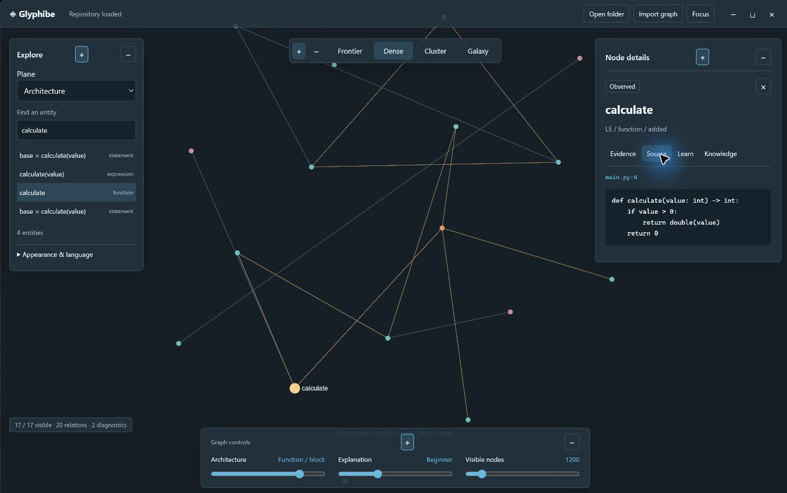
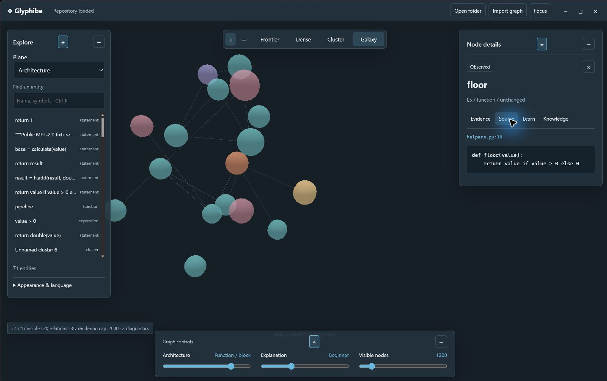

# Glyphibe

Understand a codebase by following its connections. Glyphibe turns files,
functions and smaller source structures into a graph. Select a node to inspect
evidence, trace calls, explore possible modification effects, or learn a
programming concept through a question, hint, answer and review.

Source version **1.0.0**. Installers are unsigned. Published distributions and
their approval status are listed in [GitHub Releases](https://github.com/styayur/glyphibe/releases).
The [release gates](docs/development/release-gates.md) distinguish completed checks,
remaining work and performance limits. [中文说明](README.zh-CN.md).



Captured from the actual installed Windows application; this is source from the
project's original public test fixture. See the release gates for validation status.



## Capabilities

- Local Python, Rust, JavaScript and TypeScript/TSX Tree-sitter parsing, with
  conservative cross-file calls, imports, references and type relations.
- One evidence-bearing graph shared by desktop, CLI and standard stdio MCP.
  MCP lets an external Agent query named tools within a chosen repository.
- Six granularities from domain to expression, on architecture and explanation
  planes, with many-to-many source mappings and explicit stale relationships.
- Deterministic Louvain communities, separate directory components, cycle
  detection, call traces and directional modification reachability.
- Original bilingual concept knowledge, prerequisite routes and four independent
  teaching depths. Questions gradually reveal syntax and evidence.
- Frontier, Dense, Cluster and true 3D Galaxy views on a full-window canvas,
  with glass islands, keyboard controls, focus mode and opaque fallback.
- External SQLite caches, content hashes, identity reconciliation, bounded
  scanning, cancellation and actual file progress.

The core works without a model, API key or cloud service. It never executes a
scanned project or installs its dependencies. Explicit GitHub knowledge imports
use the network and remain untrusted local-only material.

## Install published packages

Open [Releases](https://github.com/styayur/glyphibe/releases) and read the
validation notes for the published version. Windows x64 distributions are:

| File | Use |
|---|---|
| `Glyphibe_1.0.0_x64-setup.exe` | Desktop installer; launch Glyphibe after installation |
| `Glyphibe-1.0.0-windows-x64-portable.zip` | Extract together, then run `glyphibe-desktop.exe` |
| `Glyphibe-1.0.0-windows-x64-cli.zip` | Extract together; run `glyphibe.exe --help` without a GUI |

Keep the included `licenses` directory. The separate CLI executable should be
accompanied by `Glyphibe-1.0.0-licenses.zip`. Desktop requires Microsoft WebView2.
The CLI requires the [Microsoft Visual C++ v14 x64 Runtime](https://learn.microsoft.com/en-us/cpp/windows/latest-supported-vc-redist).
Packages are unsigned and Windows may display publisher/SmartScreen warnings.
Compare `Get-FileHash FILE -Algorithm SHA256` with the published `SHA256SUMS`.
See the [installation guide](docs/user-guide/installation.md) and release gates
for platform and lifecycle evidence. A source version alone does not mean a
download has been approved or published.

## Build from source

Install Rust 1.98.1, Node.js 24 or newer, and the platform
[Tauri prerequisites](https://v2.tauri.app/start/prerequisites/). Windows needs
MSVC Build Tools and WebView2. From this trusted project's checkout:

```sh
cargo install --locked --path crates/glyphibe-cli
glyphibe analyze tests/fixtures/python
glyphibe --repo tests/fixtures/python search calculate
cd apps/desktop
npm ci
npm run tauri -- dev
```

`npm run tauri -- build --bundles nsis` builds a Windows development installer.
Build success is separate from installation verification. Unsigned programs
can trigger Windows publisher or SmartScreen warnings.

## First use

1. Choose **Open folder** in the desktop app; ordinary directories without Git
   work too. The cache stays in the app's user cache directory.
2. Search for a filename/function or select a node. **Evidence** shows provenance
   and mappings; **Source** shows a freshness-checked source excerpt.
3. Switch between **Frontier** (local neighborhood), **Dense** (current-level
   network), **Cluster** (communities/components) and **Galaxy** (rotatable 3D).
4. Change **Architecture** through six levels. Follow `maps_to` or switch planes
   to move between structure and explanation. **Explanation** independently
   chooses one of four learning depths.
5. In **Learn**, answer a question before revealing its hint and answer.
   **Knowledge** links concepts, prerequisites and attribution.
6. Adjust impact direction and hops in **Evidence** to highlight possible
   dependencies and inspect paths. Reachability is not a failure probability.

Use Ctrl+K to search, Ctrl+O to open, F for focus and Esc to restore chrome.
Pin/collapse islands or choose dark/light and opaque panels. The browser imports
`glyphibe export` JSON; full source teaching uses the desktop Rust host.

See the [desktop guide](docs/user-guide/desktop.md),
[CLI/MCP guide](docs/user-guide/cli-and-mcp.md) and
[knowledge/teaching guide](docs/user-guide/knowledge-and-teaching.md).

## Limits, evidence and privacy

Observed means syntax facts; Inferred means algorithmic derivation; Proposed
means an unaccepted suggestion; Verified requires independent evidence. A
structural community does not prove a business domain. Dynamic calls, reflection,
unproven cross-language bridges, wildcard/re-exports, TypeScript path aliases and
custom Rust source layouts have limitations. LSP enrichment is not implemented.
Lessons explain recorded syntax and concepts, not runtime values or proven
business intent. Source stays local during core analysis.

The [benchmark reports](docs/benchmarks/) separate measurements from unverified
targets. Density changes projection rather than facts; 2D has a 10,000-node cap
and Galaxy a 2,000-node maximum with device fallback. Default scan budgets are
20,000 files, 2 MiB per file, 256 MiB source and 250,000 extracted facts.
Broader platform and installation claims require recorded validation.

Original code and original default knowledge use MPL-2.0. Dependencies retain
their licenses: [THIRD_PARTY_NOTICES](THIRD_PARTY_NOTICES),
[inventory](docs/development/dependency-inventory.json),
[research](docs/research/competitive-analysis.md). Restricted reference source
was not copied. Read [SECURITY.md](SECURITY.md), [CONTRIBUTING.md](CONTRIBUTING.md)
and [SUPPORT.md](SUPPORT.md).
